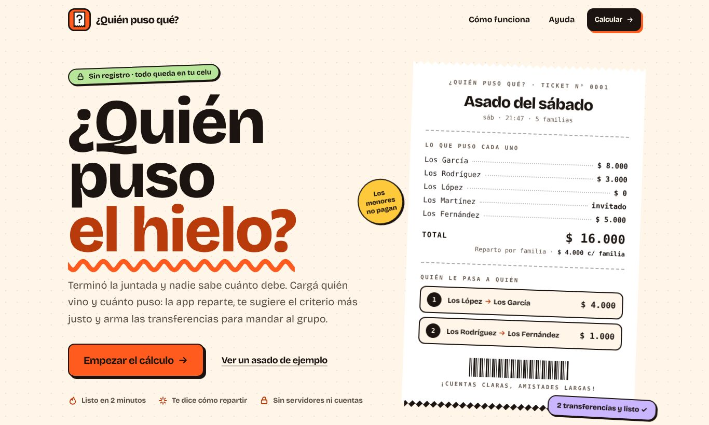
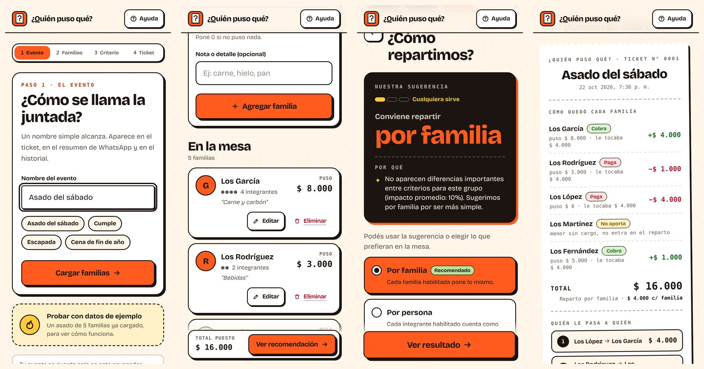
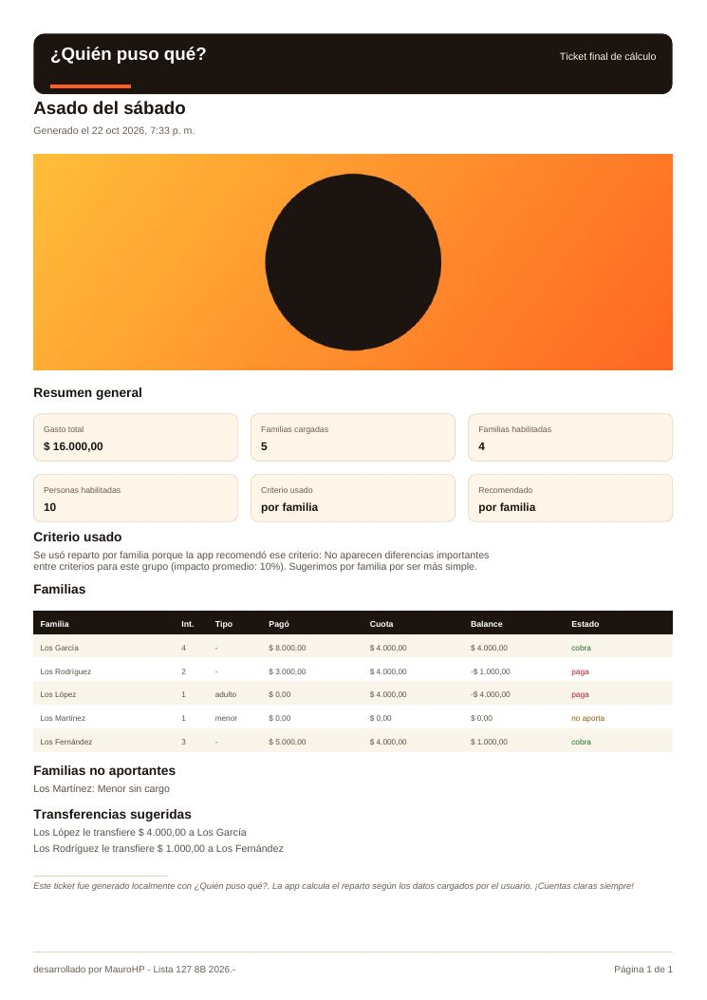

# ¿Quién puso qué?

**Repartí los gastos del asado sin planillas ni discusiones.** Cargás quién vino y cuánto puso; la app reparte por familia o por persona, te sugiere el criterio más justo y arma las transferencias mínimas para mandar al grupo, con resumen para WhatsApp y ticket PDF.

Sin registro, sin backend, sin base de datos: todo corre en el navegador.



> Deploy: `https://quien-puso-que.vercel.app` (pendiente del primer deploy). Para verlo localmente: `npm install && npm run dev`.

## El problema

Termina la juntada. Una familia compró carne, otra llevó bebidas, alguien pagó el hielo, otra no puso nada todavía y hay un menor invitado que no debería entrar en la cuenta. La pregunta aparece sola:

> ¿Quién le debe cuánto a quién?

## Cómo se usa



1. **Evento**: le ponés nombre a la juntada.
2. **Familias**: quién vino, cuántos son y cuánto puso. Un menor que viene solo no aporta.
3. **Criterio**: la app recomienda repartir por familia o por persona, explica por qué y muestra cuánto le tocaría a cada uno con cada criterio. Decidís vos.
4. **Ticket**: balances, transferencias numeradas, copiar para WhatsApp, PDF y guardar en el historial.

La ayuda para usuarios está en `/ayuda`.

## Lo que hay detrás

| | |
|---|---|
| **Motor de cálculo puro** | Elegibilidad, recomendación, balances y transferencias son funciones puras en `lib/calculations/`, sin React. Las transferencias usan aritmética entera para no arrastrar errores de punto flotante. |
| **Flujo como máquina de estados** | `lib/flow/eventFlow.ts` es un reducer puro y testeado: no lee storage, no genera ids ni fechas. La UI solo despacha acciones. |
| **Rendimiento medido** | 16 teclas en un input pasaban de 48 operaciones de `localStorage` a 1; agregar una familia, de 33 renders a 10. Landing sin JS propio, pasos con carga diferida y jsPDF por intención. Detalle y metodología en [`docs/performance.md`](docs/performance.md). |
| **Lighthouse móvil** | Performance 98–99 y **100** en accesibilidad, buenas prácticas y SEO en las tres rutas. CLS 0. |
| **Sin flash al volver** | Si hay una cuenta a medio hacer, un script inline decide antes del primer paint qué mostrar; nunca se ve el paso 1 para después saltar. |
| **Probado de punta a punta** | 50 tests unitarios (Vitest) y 24 E2E (Playwright, móvil y desktop) sobre el build de producción: portapapeles, descarga y validación del PDF, recarga inmediata, teclado, recorte de foto. Un error de consola hace fallar el test. |
| **Privacidad por diseño** | El cálculo, el borrador, el historial y la foto del ticket nunca salen del navegador. |

## Reglas de negocio

### Quién aporta

La regla vive en `lib/calculations/eligibility.ts`.

| Caso | Entra en el reparto | Personas habilitadas |
|---|---:|---:|
| 1 adulto | Sí | 1 |
| 1 menor | No | 0 |
| 2 o más integrantes | Sí | cantidad de integrantes |

Una familia de 1 menor queda como **no aportante**: no paga, no cobra y no genera transferencias. Por eso el formulario bloquea su monto en $0.

### Por familia o por persona

```text
por familia:  cuota = gasto_total / familias_habilitadas
por persona:  cuota_familia = (gasto_total / personas_habilitadas) * integrantes_habilitados
```

Por familia es simple y sirve con grupos de tamaño parecido. Por persona es más fino cuando hay familias chicas y grandes.

### Recomendación

`lib/calculations/recommendSplitMode.ts` calcula métricas del grupo y genera señales con peso:

- Muchas familias de 1 adulto favorecen `by-person`.
- Muchas familias grandes favorecen `by-family`.
- Si el impacto económico entre criterios es alto, favorece `by-person`.
- Si el impacto es bajo y los tamaños son parecidos, favorece `by-family`.
- Sin señales fuertes, sugiere `by-family` por simpleza, con confianza baja.

La recomendación es una ayuda: siempre se puede elegir otro criterio. Más en [`docs/recommendation-criteria.md`](docs/recommendation-criteria.md).

### Balances y transferencias

```text
balance = monto_pagado - cuota_esperada
```

| Balance | Estado | Significado |
|---:|---|---|
| mayor a 0 | cobra | puso de más |
| menor a 0 | paga | puso de menos |
| igual a 0 | equilibrado | está justo |
| familia no elegible | no aporta | no entra en el reparto |

El estado lo calcula `calculateBalances`; la UI no lo reinterpreta. Las transferencias (`calculateTransfers`) emparejan deudores y acreedores de mayor a menor con un greedy determinístico, en pesos enteros, para minimizar la cantidad de movimientos. Modelo completo en [`docs/calculation-model.md`](docs/calculation-model.md).

## Ejemplo completo

Evento: **Asado del sábado**

| Familia | Integrantes | Tipo | Pagó |
|---|---:|---|---:|
| Los García | 4 | - | $8.000 |
| Los Rodríguez | 2 | - | $3.000 |
| Los López | 1 | adulto | $0 |
| Los Martínez | 1 | menor | $0 |
| Los Fernández | 3 | - | $5.000 |

Total: **$16.000**. Familias habilitadas: 4. Personas habilitadas: 10. Los Martínez no aportan.

Por familia, cada una pone `16.000 / 4 = 4.000`:

- Los López le transfieren $4.000 a Los García.
- Los Rodríguez le transfieren $1.000 a Los Fernández.

Este mismo cálculo es el ticket de muestra de la landing: se genera en build con el motor real. Más casos en [`docs/examples.md`](docs/examples.md).

## Ticket PDF



Se genera en el navegador con `jsPDF` (sin screenshots ni servidor) e incluye resumen, criterio, tabla de familias, no aportantes y transferencias. La foto opcional se recorta al formato del ticket sin deformarse y no se guarda en ningún lado. Detalle en [`docs/pdf-ticket.md`](docs/pdf-ticket.md).

## Persistencia local

| Clave | Contenido |
|---|---|
| `quien-puso-que:current-draft` | la cuenta en edición; se guarda sola (debounce + al cerrar la pestaña) |
| `quien-puso-que:closed-events` | historial de cuentas cerradas (máximo 50) |

Todo lo que se lee del storage se valida antes de usarlo. Si el navegador bloquea `localStorage`, la app sigue funcionando sin persistencia.

## Stack

- Next.js 16 (App Router, Turbopack) · React 19 · TypeScript
- Tailwind CSS v4 con tokens propios
- jsPDF (carga diferida) · nanoid
- Vitest · Playwright · Lighthouse
- Tipografía: Bricolage Grotesque (OFL), subset propio autoalojado

## Estructura

```text
app/                  rutas: landing, /calcular, /ayuda, metadatos, íconos
components/
  landing/            secciones de la landing (Server Components)
  calculator/         CalculatorApp: estado y flujo; fallback; stepper
  event/ families/    pasos 1 y 2
  recommendation/     paso 3
  results/            ticket, WhatsApp, PDF
  history/ help/      historial y ayuda
  ui/ layout/         primitivas, íconos, header, footer
hooks/                persistencia del borrador
lib/
  calculations/       motor de cálculo (puro)
  flow/               reducer del flujo y derivados
  forms/ image/ pdf/  validación, foto, PDF
  storage/            acceso defensivo a localStorage
  text/ formatting/   WhatsApp, moneda, fechas
types/                contratos
tests/  e2e/          unitarios y E2E
scripts/perf/         medición de red y renders
docs/                 producto, cálculo, UX, PDF y rendimiento
```

Regla principal: **la lógica de negocio no va en componentes React**. Ver [`CLAUDE.md`](CLAUDE.md) / [`AGENTS.md`](AGENTS.md).

## Correr localmente

```bash
npm install
npm run dev          # http://localhost:3000
```

Verificación:

```bash
npm test             # unitarios
npm run lint
npm run build
npx playwright install chromium   # una sola vez
npm run test:e2e     # E2E sobre el build de producción
```

Si el entorno ya tiene un Chromium, `PLAYWRIGHT_CHROMIUM_PATH=/ruta/a/chrome npm run test:e2e`.

## Desplegar en Vercel

1. Subir el repo a GitHub.
2. Importarlo desde Vercel con la configuración automática para Next.js.
3. Deploy. No requiere variables de entorno; Vercel Analytics se activa solo dentro de Vercel.

## Estado

- [x] Landing y calculadora mobile first.
- [x] Alta, edición y eliminación de familias.
- [x] Reglas de elegibilidad, reparto por familia y por persona.
- [x] Motor de recomendación con comparación por familia.
- [x] Balances y transferencias mínimas.
- [x] Resumen para WhatsApp con fallback de copiado.
- [x] Borrador e historial locales.
- [x] Ticket PDF con foto opcional.
- [x] Ayuda para usuarios finales.
- [x] Tests unitarios y E2E.
- [x] Accesibilidad AA (Lighthouse 100).

## Roadmap

- Exportar o compartir eventos cerrados.
- Modo offline con service worker.
- Soporte opcional para más monedas.
- Monitoreo de errores en producción (Sentry con carga diferida).

## Licencia

Código bajo licencia MIT. La tipografía Bricolage Grotesque se distribuye bajo SIL Open Font License 1.1 (`app/fonts/OFL.txt`).

## Filosofía

- Cálculos claros antes que magia.
- UI amable, pero resultados precisos.
- Sin backend mientras el problema pueda resolverse bien en el navegador.
- Separación estricta entre lógica de negocio y componentes.
- Medir antes de optimizar.
- Texto en español argentino, directo y sin solemnidad innecesaria.

¡Cuentas claras siempre!
